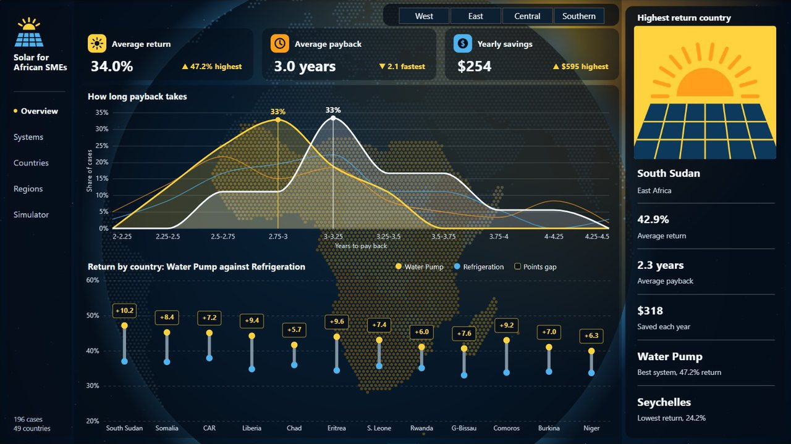
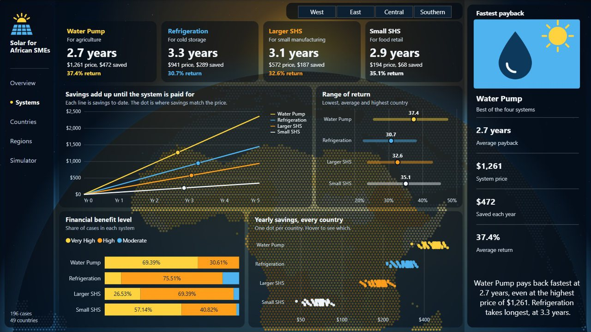
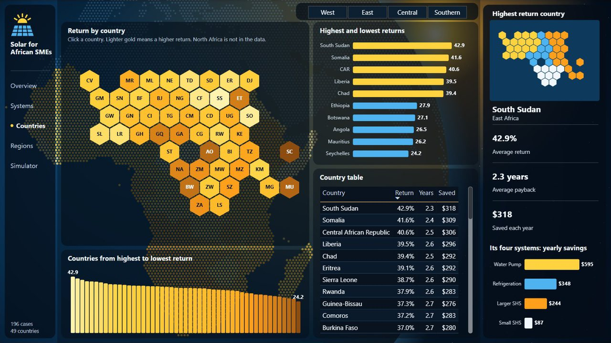
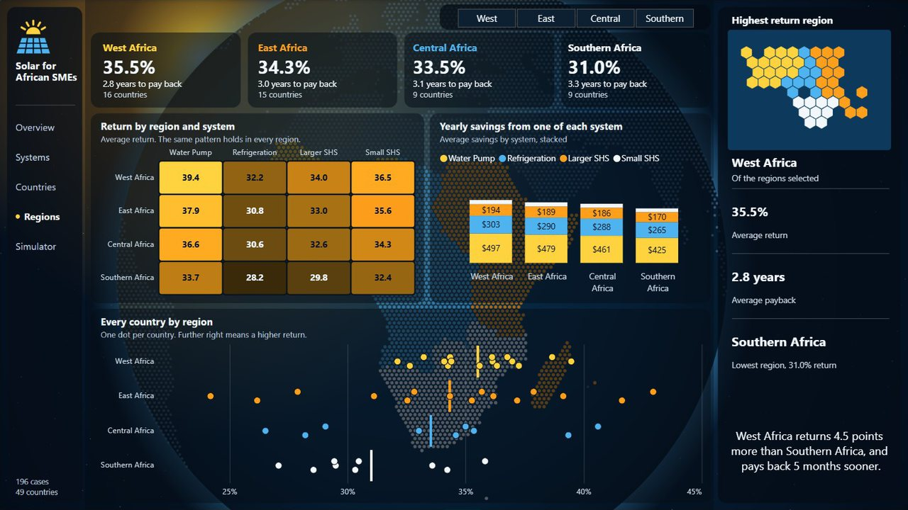
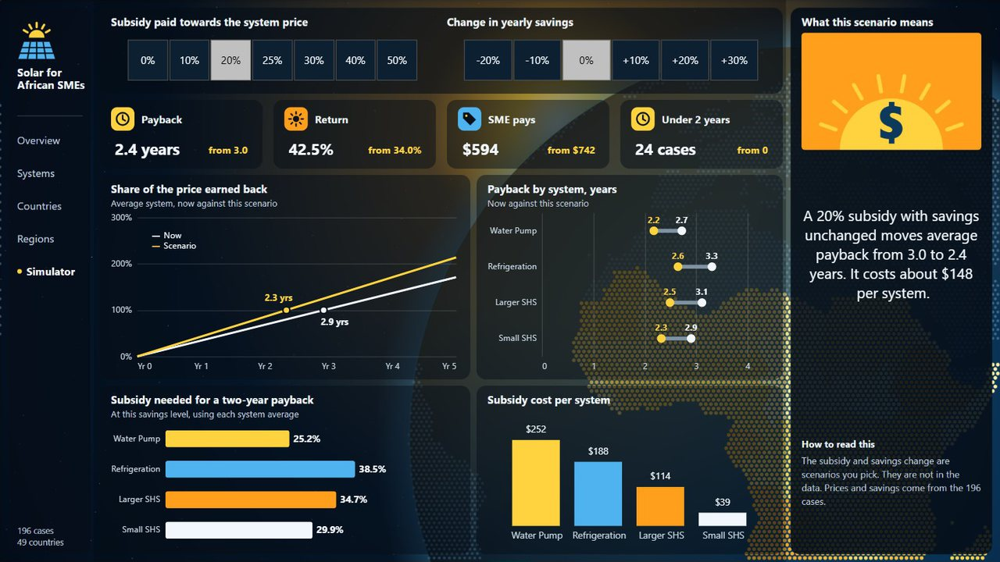

<div align="center">

# Solar for African SMEs

**Does off-grid solar pay for itself for small businesses in Africa, and how fast?**

[**▶ Watch every page (51 seconds)**](https://bihbrandysango-cloud.github.io/projects/solar/) · [**📄 Pitch deck (PDF)**](docs/Solar-Pitch-Deck.pdf)

</div>

[](https://bihbrandysango-cloud.github.io/projects/solar/)

A five-page Power BI report that compares the cost, yearly savings, return and payback of four off-grid solar systems used by small and medium businesses in 49 African countries.

- 📊 [Power BI project](powerbi/) (open `Solar for African SMEs.pbip` in Power BI Desktop)
- 🗂️ [Dataset (CSV)](data/expanded_solar_financial_impact.csv), which GitHub previews as a table
- 📄 [Pitch deck (PDF)](docs/Solar-Pitch-Deck.pdf) · [PowerPoint](docs/Solar-Pitch-Deck.pptx)

---

## What is in the report

| Page | What it shows |
|---|---|
| Overview | Return, payback and savings, how long payback takes by region, and the Water Pump against Refrigeration gap in the 12 highest-return countries |
| Systems | Four clickable system cards, how savings add up to each price, the range of return and savings in every country |
| Countries | A clickable honeycomb map of 49 countries, highest and lowest returns, and the selected country's four systems |
| Regions | Return by region and system, stacked savings and every country as a dot |
| Simulator | Pick a subsidy and a change in savings to see payback, return and the subsidy each system needs for a two-year payback |

Each page has a dotted globe of Africa as its background, coloured from the data. A region filter carries across pages. Built with Power BI, DAX (58 measures), Power Query and Deneb.

---

## Headline findings

| Metric | Value | Note |
|---|---|---|
| Average return on investment | **34%** per year | Range 22.8% to 47.2% |
| Average payback period | **3.0 years** | Fastest 2.1 years, slowest 4.4 years |
| Average system price | **$742** | From $194 for a small home system to $1,261 for a water pump |
| Average yearly savings | **$254** per business | From $47 to $595 |
| Cases rated High or Very High benefit | **187 of 196** | 95% of all country and business combinations |

---

## The question

Diesel generators and unreliable grid power are a large running cost for small businesses across Africa. Solar systems cost more up front, so an owner needs to know two things before buying: how much the system saves each year, and how many years it takes to earn back its price.

This project answers that for four business types, four regions and 49 countries.

---

## Key insights

1. **The most expensive system pays back fastest.** Solar water pumps for agriculture cost the most ($1,261) but save $472 a year, which gives the best ROI (37.4%) and the shortest payback (2.7 years). Price alone is a poor guide to value.

2. **Small home systems are the cheapest way in.** At $194, a 3–49 Wp system for food retail returns 35.1% and pays back in 2.9 years. For a business with little cash, it is the lowest-risk start.

3. **Solar refrigeration has the weakest case, and it still pays.** Cold storage systems return 30.7% and pay back in 3.3 years. That is the slowest of the four, and it still earns back its price in under four years.

4. **West Africa gets the best returns.** West Africa averages 35.5% ROI and a 2.8-year payback. Southern Africa is lowest at 31.0% and 3.3 years.

5. **Only 9 of 196 cases are "Moderate".** Those average a 4.2-year payback. Every other case is High or Very High.

6. **A partial subsidy goes a long way.** A 20% subsidy cuts the average payback from 3.0 to 2.4 years, at about $148 per system. A water pump needs about 25% to pay back in two years; refrigeration needs about 39%.

| System | Business type | Price | Yearly savings | ROI | Payback |
|---|---|---|---|---|---|
| Solar Water Pump | Agriculture | $1,261 | $472 | 37.4% | 2.7 yrs |
| Small SHS (3–49 Wp) | Food Retail | $194 | $68 | 35.1% | 2.9 yrs |
| Larger SHS (50 Wp+) | Small Manufacturing | $572 | $187 | 32.6% | 3.1 yrs |
| Solar Refrigeration | Cold Storage | $941 | $289 | 30.7% | 3.3 yrs |

---

## Recommendations

| Priority | Action | Expected impact |
|---|---|---|
| High | Lead lending and grant programmes with solar water pumps for farms | Highest savings per business and the fastest payback |
| High | Offer small home systems to cash-poor retailers on pay-as-you-go terms | Low entry price, 2.9-year payback |
| Medium | Pair solar refrigeration with longer loan terms | Its 3.3-year payback is the slowest of the four |
| Medium | Study why Southern Africa returns less | 4.5 points of ROI behind West Africa |

---

## Pages

### 1. Overview


### 2. Systems



### 3. Countries



### 4. Regions



### 5. Simulator



---

## Data

The dataset has 196 rows: 49 countries × 4 system types. Each row is one country and one business type.

| Column | Description |
|---|---|
| `Country` | One of 49 African countries |
| `Region` | West, East, Central or Southern Africa |
| `SME_Type` | Agriculture, Food Retail, Small Manufacturing or Cold Storage |
| `System_Type` | The solar system used by that business type |
| `Avg_System_Price_USD` | Average purchase price of the system |
| `Annual_Savings_USD` | Average yearly saving against the business's previous energy cost |
| `ROI_Percent` | Yearly savings as a percentage of the system price |
| `Payback_Period_Years` | System price divided by yearly savings |
| `Financial_Benefit_Level` | Moderate, High or Very High |

The Power BI model adds three small lookup files built from the dataset: `geography.csv` (region, short name and map position for each country), `systems.csv` (short name and business type for each system) and `levels.csv` (benefit level order).

---

## Repository structure

```
solar-sme-financial-impact/
├── README.md
├── LICENSE
├── data/
│   ├── expanded_solar_financial_impact.csv   Full 196-row dataset
│   ├── geography.csv, systems.csv, levels.csv   Lookup tables for the model
│   └── solar_financial_impact.xlsx           Source workbook
├── docs/
│   ├── Solar-Pitch-Deck.pdf                  Pitch deck, renders inline on GitHub
│   ├── Solar-Pitch-Deck.pptx                 Editable PowerPoint
│   └── screenshots/power-bi/                 One picture per page
└── powerbi/
    ├── Solar for African SMEs.pbip            The Power BI project (current report)
    ├── Solar for African SMEs.Report/
    ├── Solar for African SMEs.SemanticModel/
    └── Financial_Impact_Dashboard.pbix       First version of the report
```

## Run it locally

1. Clone or download this repository.
2. Open `powerbi/Solar for African SMEs.pbip` in Power BI Desktop (free from Microsoft). The Deneb visual is included in the project.
3. The saved data opens straight away. To refresh it, set the `DataFolder` parameter (Transform data › Edit parameters) to this repository's `data\` folder, ending with a backslash.

The first version of the report is kept as `powerbi/Financial_Impact_Dashboard.pbix`.

---

## Limitations

- **Each business type uses one system.** Agriculture always uses a water pump, food retail always a small home system, and so on. Business type and system type can't be compared separately.
- **System prices are the same in every country.** Only the savings change by country, so the regional differences come from savings alone. Real prices vary with import duties and local suppliers.
- **No financing costs.** ROI and payback ignore loan interest, maintenance and battery replacement, so real payback will be longer.

---

## Tech stack

| Layer | Tool |
|---|---|
| Data preparation | Excel, Power Query |
| Modelling and measures | Power BI, DAX (58 measures) |
| Visualisation | Power BI Desktop, Deneb (Vega-Lite) |

---

## License

Released under the MIT License. See [LICENSE](LICENSE).

---

**Built by Bih Brandy Sango** · Data Scientist and BI Analyst
